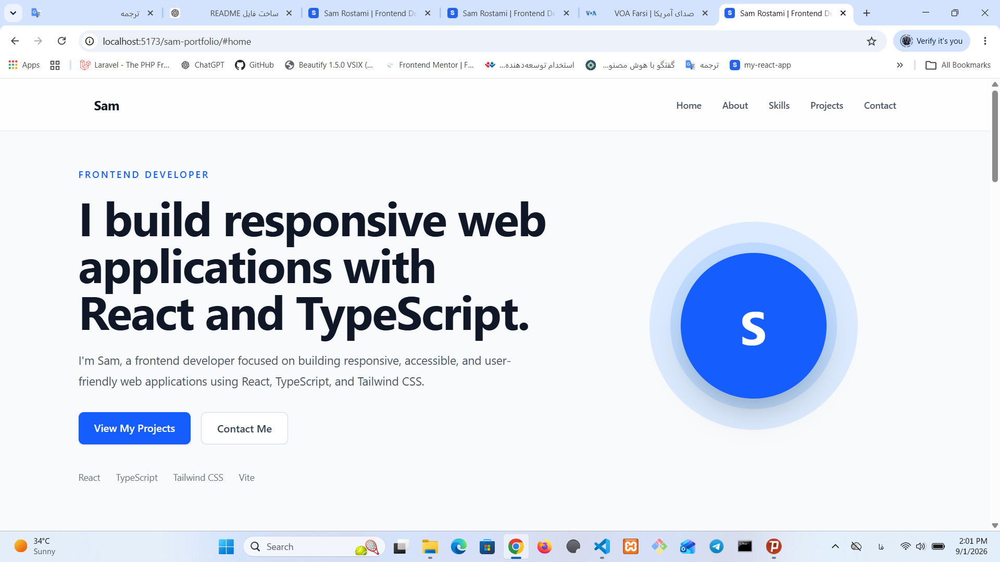

# Sam Portfolio


A modern and responsive frontend developer portfolio built with React, TypeScript, and Tailwind CSS.

## Live Demo

🌐 https://sam59246677.github.io/sam-portfolio/

## About The Project

This portfolio website showcases my frontend development skills, projects, and experience building modern web applications.

The goal of this project was to create a clean, responsive, and accessible personal website using modern frontend technologies.

## Built With

- React
- TypeScript
- Tailwind CSS
- Vite
- Git & GitHub

## Features

- Responsive design for mobile, tablet, and desktop
- Component-based React architecture
- Type-safe development with TypeScript
- Modern UI built with Tailwind CSS
- Project showcase section
- Contact section
- Optimized production build with Vite

## Projects Included

### Sam's Bookstore

A responsive online bookstore application where users can:

- Browse products
- Add items to cart
- Manage cart items
- Complete checkout process

Technologies:

- React
- TypeScript
- Tailwind CSS
- React Router


## Installation

Clone the repository:

```bash
git clone https://github.com/sam59246677/sam-portfolio.git